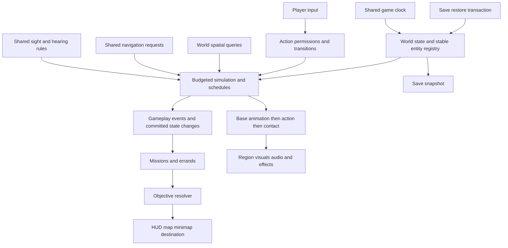

# Game logic and integration audit

Authored source review, 11 October 2026 IST. Scope: repository-wide code inventory and subsystem source tracing; recommendations only. Concurrent production and asset changes were preserved. This document is architecture analysis, not a generated test report or gameplay approval.

Implementation update: the user approved this order. See [shared logic integration](shared_game_logic_integration.md) for the current implemented contracts, native/source regression results, measured discovery benefit and opt-in presentation pilot. The table/findings below describe the original audit snapshot; several listed defects are now fixed. Full gameplay/FPS and broader migration remain open.

## What the review establishes

The game has substantial purposeful logic. Its main weakness is inconsistent coordination and cost control across otherwise connected systems. Clock, inventory, saves, terrain layout, imported human assets and some simulation budgets already form shared foundations. Navigation, action exclusion, destination arbitration, lifecycle and expensive contact work need stronger shared contracts.

Inventory at review time: 804 GDScript files, 188 Python files and 50 shaders outside Git/import caches. Of the GDScript files, 469 are under tools, two are editor addons, six are forest review fixtures, and 327 are production candidates across world, player, story, systems, characters, vehicles, animals, horses, combat, objects, interaction, UI and environment. Those production candidates contain 45,493 lines and 139 process/physics callback definitions. Fifteen scripts reference the shared simulation budget, 27 reference startup coordination, 44 use group-list lookup and 118 use recursive child lookup. These are code counts, not live instance counts, costs or proof that every candidate executes in the main world.

All code areas were inventoried; central update, save, loading, routing, perception, mission, interaction and contact implementations were inspected directly. Build/export/validation scripts and shaders were classified as tooling or presentation code; this is not a line-by-line proof of all tooling, shader correctness, asset deformation or every gameplay branch. No fresh native benchmark, complete playthrough or new runtime regression was run in this review. Existing performance/crime documentation is historical corroboration, labelled below. Dirty concurrent sources mean this is a working-tree observation, not an immutable release audit.

## System logic table

“Sound” means the algorithm and intended contract are reasonable in inspected source, not that all edge cases have passed. “Mixed” means useful logic with a material integration/cost limitation. “Defect” identifies a concrete source problem. Efficiency refers to workload structure unless a measurement is explicitly identified.

| System and source | Algorithm / logic | Existing connections | Correctness assessment | Efficiency assessment / next improvement |
| --- | --- | --- | --- | --- |
| [Main world](../../world/suryagarh/suryagarh_world.gd), [scene](../../world/suryagarh/suryagarh_world.tscn) | Installs world modules; waits for builders; bounds player; computes river state | Player, terrain, errands, story, population, save manager | Mixed: genuine orchestration, but named nodes and installation sequence encode dependencies implicitly | Startup is amortised; root retains baked landscape and many scene/resources. Introduce explicit readiness/dependency contracts before region work |
| [Loading](../../ui/journey_loading.gd), [startup](../../systems/world_startup.gd) | Threaded resource request/status polling; main-thread instantiate; cooperative 8,000 µs checkpoints; task barrier | Menu, world builders, collision registration, save restore, opening reveal | Sound separation of loading and gameplay; label-based waits remain brittle | Checkpoints cannot preempt one long instantiate/solver operation. Measure largest uninterrupted stage; bounded jobs must yield inside heavy work |
| [World ownership](../../systems/world_context.gd) | Ascends parents to a world with GameTimeSystem | Several actors/services/journeys | Mixed: safer ownership resolution exists, but adoption is incomplete | Cache setup references per world; replace global recursive resolution only where lifecycle or cost evidence warrants it |
| [Game clock](../../world/suryagarh/systems/game_time_system.gd) | Absolute game minutes, readable time derivation, elapsed-time signals, keyed non-compounding mission slowdown | Survival, lighting, hours, story, sleep/travel | Sound shared authority; real-time and game-time consumers intentionally differ | Cheap central arithmetic. Define explicit jump/reconciliation semantics for schedules |
| [Player locomotion](../../player/player_controller.gd) | Acceleration/deceleration, gravity, move_and_slide, step up/down, swim current, actual travelled sprint effort | Survival, stance, camera, interactions, ride/climb, action flags | Sound core; numerous independent metadata gates make exclusions difficult to keep consistent | Nearby control must remain full rate. Consolidate permissions without moving all player work into a giant scheduler |
| [Camera](../../player/camera_clearance.gd), [first-person](../../player/first_person_view.gd) | View switching and clearance/aim placement | Player, equipment, indoors, settings | Dedicated logic exists; clearance/feel needs rendered route validation | Keep immediate camera response; share action/camera ownership during transitions |
| [Interaction selection](../../player/player_controller.gd#L792), [overlay](../../interaction/interaction_overlay.gd) | Squared-range rejection, availability, facing score, projection, occlusion rays; held actions | Interactable contract, inventory, world targets, audio, feedback | Mixed: selection respects door anchors, but held-target retention uses root distance; inspect latch hold boundary explicitly | Selector and overlay independently scan global interactables each physics tick: O(I) twice before local filtering. Add a world spatial broad phase and share candidates |
| [Inventory](../../player/inventory_component.gd), [consumption](../../player/consumable_component.gd), [catalog](../../interaction/item_catalog.gd) | Count/capacity accounting, item use and notifications | Pickups, weapons, jobs, survival, HUD, save | Sound shared state foundation | Mostly event-driven. Use one transaction contract for reward/consume/handover to prevent partial or repeated completion |
| [Survival](../../player/survival_component.gd) | Game-hour hydration/satiety/energy/warmth rates; real-time stamina and heat checks | Clock, movement, consumables, heat sources, HUD, save | Sound distinction between long-term needs and moment-to-moment exertion | Small player workload; retain authoritative elapsed-time updates across sleep/travel |
| [Sleep](../../objects/charpai.gd), [water](../../player/river_water_component.gd), [item motion](../../player/item_use_animation.gd) | Timed settle/use/wake phases; sleep advances shared clock and restores energy | Player locks, survival, inventory, animations | Mixed: real state transitions, with local collision/input restoration responsibilities | No reason for global per-frame work when inactive. Central action cleanup should cover cancellation, death and scene exit |
| [Combat input](../../player/combat_input.gd), [melee](../../player/melee_motion.gd), [damage policy](../../combat/damage_policy.gd) | Single/double click dispatch, timed strike windows, shape/ray hits, faction damage filtering | Equipment, animations, vitality, crime observers | Sound central damage policy; attack-specific permissions still distributed | Event/window-driven collision is appropriate. Standardize action entry/exit and hit ownership |
| [Firearms](../../player/rifle_combat.gd), [pistol](../../player/pistol_combat.gd), [trace](../../combat/ballistic_trace.gd) | Ammo/reload states, camera aim then muzzle trace, bounded glass penetration; shotgun pellets | Inventory, damage policy, motion, audio, save | Purposeful hitscan approximation with cover check; weapon-specific reload contracts need round-trip coverage | Bounded traces; exclusions scan groups per trace, amplified by pellets. Cache stable exclusions with lifecycle invalidation if measured significant |
| [Bow / arrow](../../player/bow_combat.gd), [projectile](../../environment/weapons/period_arrow/arrow_projectile.gd) | Draw fraction, inventory debit, launched projectile and swept hit logic | Equipment, damage, audio | Distinct projectile logic exists; bow aim uses a different sight path from firearm helper | Bounded active projectiles. Share material/occlusion semantics where intended, not weapon flight models |
| [Climb / stance](../../player/climb_component.gd), [window](../../player/window_climb.gd), [stance](../../player/stealth_stance.gd) | Opportunity/clearance checks, staged traversal, surface/contact targets, concealment | Player collision, animation, camera, perception, clothing | Sound feature logic; action flags and pose writers need explicit precedence | Keep near collision/contact immediate; cache immutable surface data and avoid duplicate searches |
| [Hero AnimationTree](../../player/arjun_motion_tree.gd), [visual](../../player/arjun_visual.gd) | Locomotion blends, action layers, procedural clips and contact corrections | Movement, combat, climb, rest, detention, equipment | Tree wiring exists; structural correctness does not establish motion/clothing/contact approval | Many pose/contact layers can repeat bone work. Explicit phase order: base pose → action layer → contact → attachments |
| [Humans](../../characters/human_scene.gd), [NPC actors](../../characters/npcs/households/household_npc_actor.gd) | Imported MakeHuman scene reuse, shared immutable geometry, private mutable animation libraries/rigs | World population, story, work, combat, contact | Good resource ownership pattern; full-body/appearance acceptance is separate | Preserve shared geometry and independent pose state; avoid runtime GLB decoding or indiscriminate deep mesh duplication |
| [Pouch contact](../../player/water_bag_visual.gd) | Cached vertex/bone-bind samples, CPU skinning, max support reduction, shader deformation | Cloth rig, equipment, water fill | Contact-preserving logic; sample count controls cost | Per contact query O(samples × influences). Historical live diagnostics report 12,582 samples/~7.35 ms; investigate actual initialization before changing samples or solver |
| [Pedestrian routes](../../world/suryagarh/city_street_journey.gd), [base](../../world/suryagarh/settlements/street_journey.gd) | Waypoint travel, turn/brake, support ray, swept capsule plus destination overlap, local detours, elapsed-time slices | Clock, terrain, actor animation, social index, simulation tiers | Strong collision-aware route foundation; global routing completeness remains unproven | Good near/full and remote/reduced logic; remote 0.5-second updates still replay 0.1-second collision slices, so batching is not a fivefold reduction in all work |
| [Population social](../../world/suryagarh/population_social.gd) | 5 m spatial hash, neighbour queries, mutual conversation leases, traffic pace | City journeys, carts, clock, combat/mission exclusions | Useful shared coordinator already implemented | Rebuilds at 0.25 s, limits social activity by distance. Reuse this pattern for interactions/perception; cart awareness still loops a cached cart array |
| [Resident work](../../world/suryagarh/settlements/resident_activity.gd), [goods](../../world/suryagarh/settlements/resident_goods_run.gd) | Job/hour state machines, home/work commutes, carry/load/deliver phases, contact | Roles, workplaces, carts, save, clock | Purposeful persistent behaviours; important action/mission exemptions are not uniform across budget consumers | Bounded slices and elapsed accumulation are good. Use shared essential-work predicates; reconcile clock jumps explicitly |
| [Local resident navigation](../../world/suryagarh/settlements/resident_walk_route.gd) | A*-style search with Euclidean heuristic, linear open-list minimum, ≤2,400 expansions; support/shape/swept validation | Resident activity, world physics, body capsule | Strong clearance checks; finite extent/expansion cap can return no path | Each expansion scans open list and performs physics queries; synchronous worst-case stalls are plausible. Priority queue plus budgeted search, not merely fewer collision checks |
| [Coach routing](../../vehicles/coach_routes.gd), [paid travel](../../vehicles/paid_coach_travel.gd) | Road sample graph, AStar2D, bridge lane offsets, fare debit, trip/cancel/resume states | Layout, carts, map requests, clock, inventory, parking | Shared road geometry exists; automatic proximity links need road/clearance semantics | Build connects all pairs within 11 m: O(V²), cached per travel owner. Share immutable topology per world and spatially build junction links |
| [Cart traffic](../../world/suryagarh/city_cart_journey.gd), [road travel](../../vehicles/bullock_road_journey.gd) | Lane placement, ahead-cart spacing, ground/clearance checks, waypoint travel | Shared budget, driver, boarding, terrain, jobs | Purposeful physical traffic; spacing-only coordination can still stall and needs route validation | Updates capped to 0.1 s cadence; each cart scans other carts: O(C²) aggregate. Spatial lane occupancy/reservations are a better scalable connection |
| [Riding / boarding](../../player/ride_component.gd), [cart rider](../../vehicles/cart_rider.gd), [horse](../../horses/stable_horse.gd) | Nearest eligible mount with line-of-sight, seat transitions, collision handoff, steering | Player actions, crime, cart/horse movement, save, contact | Defect at restore boundary; permission/acquisition metadata are incomplete persistence contracts | Full-rate ridden physics appropriate. Prompt searches global mounts every frame; use spatial candidates if population makes this material |
| [Seated drivers](../../vehicles/seated_coachman.gd), [cloth](../../vehicles/coachman_seated_cloth.gd) | Cart-local seating/contact, pose-keyed startup garment cache, procedural grip/lean | Seats, reins, driver rig, startup budget | Accepted cache foundation exists; currently dirty owner files require separate review | Expensive fitting moved toward prepared data; visible check is not distance/frustum eligibility. Tier optional driver detail while retaining near motion/contact |
| [Cattle / draft animals](../../animals/cow_motion.gd), [caretaker](../../animals/cattle_caretaker.gd), [vitality](../../animals/draft_animal.gd) | Gait state cycles, analytical two-bone leg IK, iterative neck/head contact, care/death state | Yards, residents, carts, terrain, save, simulation budget | Real behavioural/contact algorithms | Head solver can iterate up to 60 times. Distance tiers help; optimize only with contact error and native cost measurements |
| [Crime / street police](../../world/suryagarh/combat_encounters.gd) | Range/facing/occlusion/stance perception, bounded evidence, wanted score, last-seen pursuit, timed hidden decay | Vehicle taking, damage, custody, save, smoke, civilian/police actors | Defect: generic facing bypass ≤3 m. Search/duty return are simplified; direct goal movement is not full city navigation | Reduced idle tiers and sensing cadence exist. Share perception and route services, retaining full-rate engaged police |
| [Station custody](../../world/suryagarh/settlements/police_arrest.gd) | Arrest/fight/restraint/escort/cell/release phases; cached 89×94 AStarGrid2D; capsule/floor validation | Crime, detention pose, station staff, clock/transfers | Useful separate custody coordinator; duplicates sight rules and close-range exception | First grid build checks 8,366 cells synchronously; nearest endpoint scans all cells per request. Budget build and local endpoint search; dynamic obstacle invalidation needs explicit review |
| [Story / tutorial](../../story/opening_sequence.gd), [tutorial](../../story/morning_tutorial.gd), [Dev](../../story/dev_story.gd), [rebellion](../../story/rebellion_story.gd) | Timed cinematic beats, stages/prerequisites, playable lesson evidence, mission clock leases, export/restore | Player, inquiry, mounted travel, weapons, objectives, save | Connected sequence exists. Different directors still set action/camera/objective state independently | Event/stage-based decisions fit. Keep authoritative directors alive; scheduler should reduce optional presentation, not stop missions |
| [Errands / institutions](../../world/suryagarh/errands/errand_system.gd), [civic missions](../../world/suryagarh/settlements/civic_missions.gd), [operations](../../world/suryagarh/settlements/administrative_operations.gd) | Endpoint/prerequisite state machines, daily availability, inventory/reward transactions, service hours | Residents, inventory, clock, destinations, save | Meaningful gameplay economy and progression; separate quest completion contracts need consistent transaction semantics | Availability is generally event/interaction-driven. Keep providers modular; publish completion/state changes through typed contracts |
| [Map / guidance](../../player/world_map.gd), [marker](../../world/suryagarh/errands/destination_marker.gd), [minimap](../../player/minimap.gd) | Shared raster/waypoint, heading projection, screen-edge destination, priority overrides | Errands, inquiry, Dev, rebellion, tutorial, save | Mixed: shared map state is good, but priority is embedded across multiple consumers; map sync directly follows inquiry while marker overrides rebellion | Minimap refreshes at 10 Hz without a second 3D camera. One objective resolver should feed every consumer; preserve placement/reveal contract |
| [Terrain / settlements](../../world/suryagarh/landscape_layout.gd), [builder](../../world/suryagarh/settlements/settlement_builder.gd), [support](../../world/suryagarh/tree_trunk_collision.gd) | Shared authored routes/sites/grades, procedural assembly/bakes, terrain support/collision caches | Roads, forest, physics, population, river, maps, buildings | Common geometric basis exists; duplicated route/ground assumptions can drift | Prebake immutable detail; retain authoritative physics and revision-aware caches |
| [Forest / broadleaf](../../environment/forest/scripts/forest_generator.gd), [compaction](../../world/suryagarh/broadleaf_render_records.gd) | Seeded per-cell placement, density/slope/corridor/separation filters, chunk MultiMeshes, LOD bands, zero-basis record compaction | Terrain adapter, wind, trunk collision, startup | Good deterministic batching foundation; visual culling is not resource streaming | Shared meshes/LOD reduce draw workload. Root scene/species/cache references retain resources; unloading needs ownership work |
| [River / wildlife](../../world/suryagarh/river_dynamics.gd), [fish](../../world/suryagarh/river_fish.gd), [birds](../../world/suryagarh/sky_birds.gd) | Position-based current, deterministic oscillating fish schools, flock orbits with cached height, daylight activity | Player/boat water, layout, clock | Bounded ambient logic, not ecological simulation | Fish rewrite 144 transforms each frame; birds update 60 objects and wings. Region eligibility or shader motion are candidates, not demonstrated bottlenecks |
| [Audio / wind / grass](../../systems/world_audio.gd), [ambience](../../systems/environment_audio.gd), [wind](../../systems/wind_system.gd), [grass](../../systems/grass_motion.gd) | Bounded audio voices/loops, weak actor tracking, contact deduplication, timed ambience; global shader wind/four vehicle wakes | Actors, activities, clock, weather exposure, vegetation, settings | Good shared presentation services | Bounded effects help. Registries still scan tracked actors; wind/grass list refreshes may be spatialized if profiling warrants it |
| [Doors / pickups / reputation](../../objects/hinged_door.gd), [fame](../../player/fame_component.gd) | Door angle/tier/hours/access states, persistent pickup removal, action-based reputation thresholds | Institutions, inventory, clock, crime, save, HUD | Purposeful state models; acquisition authorization should be shared with vehicle permissions | Event-driven state changes are appropriate; cache immutable door geometry and share permission decisions |
| [Save / settings / inputs](../../systems/save_manager.gd), [feedback](../../systems/controller_feedback.gd), [touch](../../ui/mobile/touch_controls.gd) | Versioned JSON, temp-write/flush/rename, state export/restore, input-device event switching, pixel budget/settings | Almost every gameplay system | Broad integration exists; restore calls live gameplay boarding, creating unwanted side effects | Save-time scans are acceptable versus frame loops. Separate restore transactions, stable IDs and migration from settings/input responsibilities |
| Offline assets / tests / shaders | Blender/export/bake/validator workflows and GPU materials | Imported runtime scenes/resources | Essential supporting layers; their presence cannot approve final assets or gameplay | Heavy geometry fitting belongs in reusable editable/rebuild inputs where possible. Preserve MPFB full bodies; no disposable test output retained |

## Material findings with source evidence

1. **Cart restore can manufacture a theft.** `cart_save_state.collect` saves position/heading/seat/role, not `crime_taken` or acquisition permissions. `restore` calls `board_at`, whose driver path reports theft and sets `crime_taken`. SaveManager restores crime before restoring carts. Loading therefore replays a gameplay event. Source: [cart persistence](../../vehicles/cart_save_state.gd), [boarding](../../vehicles/cart_rider.gd#L136), [save restore](../../systems/save_manager.gd#L274). The existing [crime audit](crime_sight_2026-10-09.md) separately documents a reproduction; this review did not rerun it.
2. **Close witnesses have generic rear vision.** Both street `visible_to` and station `can_see` apply facing only beyond three metres. Smoke/ray occlusion remain enforced, but a close rear-facing theft witness can identify Arjun. Decide a separate hearing/touch response rather than granting visual identification to every nearby observer. Source: [street sight](../../world/suryagarh/combat_encounters.gd#L196), [station sight](../../world/suryagarh/settlements/police_arrest.gd#L189). The prior audit reports a two-metre theft reproduction.
3. **Global interaction scans are duplicated.** Player selection and marker overlay enumerate all interactables each physics update. Early range rejection saves expensive rays/availability calls but does not remove O(I) enumeration. Ride prompt separately scans mounts per frame. This is a scalability finding, not a measured current frame-time attribution.
4. **Navigation cost and semantics vary.** Station grid builds 8,366 occupancy cells on demand and scans the complete grid for endpoints. Coach graphs link all nearby point pairs. Resident local search scans its open list and makes many physics queries synchronously. Street police use collision-checked direct motion for last-seen goals rather than the same navigable route contract. These algorithms have different appropriate uses, but need one request/cost/invalidation interface.
5. **Visibility does not unload the world.** The main scene directly references the baked landscape; forest definitions retain LOD resources, generators retain meshes. Hidden/detached objects can still have live resource owners. Streaming requires lightweight state ownership plus independently loadable resource boundaries, not only distance hiding.
6. **Action ownership is distributed.** Movement, weapons, boarding, cinematic, rest, reading, detention and climbing use separate metadata gates and cleanup. This can work, but new actions must update many consumers consistently. Treat inconsistent permission/cleanup as a risk until tested, not proof that every conflict already occurs.
7. **Objective priority has multiple implementations.** The destination marker knows tutorial/rebellion/errand/story overrides; map story sync directly inspects inquiry; errands also set waypoints. A new mission can therefore require changes in several UI owners. Centralize priority while retaining manual waypoint choice and saved tutorial progress.
8. **Distance throttling is partial and does not mean proportional savings.** Fifteen source consumers is not comprehensive coverage. Some remote movement replays multiple swept steps and some clothing/contact callbacks remain eligible whenever their node is visible. Inspect physical/contact essentials per subsystem before changing cadence. A Node's visible flag alone does not establish camera-frustum visibility.
9. **Clock jumps need explicit schedule reconciliation.** Sleep advances eight game hours immediately, while many residents choose working/home goals by reading current_hour during their next movement tick. That is a valid simplified model, but does not reconstruct skipped deliveries/arrivals or all intervening daily events. Define what sleeping/travel should settle, defer or skip; test midnight and work-hour crossings.
10. **Some ownership patterns already deserve preservation.** Human geometry is shared while mutable animation libraries are private; terrain caches are revision-aware; social indexing is world-scoped; saves include stories, jobs, fame and populations; mission clock requests do not compound. Replacing these wholesale would introduce unnecessary risk.

## Existing efficiency evidence, with limits

[Runtime optimisation](runtime_optimisation.md) documents a Medium target of at most 1280×720 3D pixels, 30 FPS/33.33 ms initial budget, 60 FPS stretch. A recorded populated New Journey/cantonment walk reports p50/p95 ~94.65/105.45 ms, which misses that target. Its separate frozen-view geometry diagnostic reports ~35.03 ms baseline and ~22.13 ms with broadleaf rendering excluded; this exclusion is diagnostic, not an approved change. Manual callback diagnostics highlight pouch contact and other actor work, but are not an additive decomposition of a gameplay frame. Source/population and viewport conditions differ between runs.

Conclusion: the code contains worthwhile efficiency work, yet whole-game efficiency has not been established. The recorded walk fails the target; no fresh FPS claim is made for this checkout. A correct algorithm can still be too expensive when multiplied across many actors. A low callback count can still hide expensive physics, skinning or GPU work.

Concurrent traffic owner update observed before delivery: the handoff reports an exhaustive movement repeat still FAIL at 181/188 walkers, 18/20 police and 13/16 carts progressing, with remaining overlap/stall repairs underway. This is owner-reported behavioural evidence, not a run performed by this audit, and the ongoing fixes may change the inspected route sources. It reinforces the need to verify multi-system traffic behaviour before declaring route logic complete.

## How to interconnect the layers

Retain feature modules. Add a few world-owned contracts around the foundations already present; avoid one global manager that owns every detail.

| Shared contract | Responsibility | Producers / consumers | Why it helps |
| --- | --- | --- | --- |
| World services/context | Explicit references, ownership, setup readiness and teardown | Installed modules, actors, UI adapters | Removes repeated global discovery and ambiguous world ownership |
| Entity registry | Stable entity ID, role/faction/permissions, persistent state and loaded presentation handle | Population, vehicles, missions, saves | Scene reload/streaming no longer depends solely on generated node paths |
| Spatial query service | Nearby interactables, actors, vehicles, heat/sound sources by category | Interaction, perception, traffic, effects | Reuses spatial indexing and avoids many global scans; final ray/sweep checks remain authoritative |
| Action coordinator | Permission, priority, cancellation and cleanup leases for control/camera/collision/pose | Player actions, UI, cinematics, custody | One consistent answer to “can move/attack/board/read now?” with safe transition cleanup |
| Simulation scheduling | Reuse Budget thresholds; phase jobs; bound remote work; mark mission/combat/contact essentials | Autonomous behaviours and optional effects | Spreads work without dropping elapsed time or disabling nearby play |
| Navigation service | Shared immutable road topology, local search interface, actor radius/height constraints, invalidation revisions, budgeted requests | Coaches, residents, pursuit, institutions | Reuses route knowledge and provides bounded cost while retaining actor-specific clearance |
| Perception service | Range/facing/head-awareness, occlusion, stance/smoke, separately defined hearing | Police, witnesses, combat AI | Prevents drift between station and street rules and duplicate sensing |
| Objective resolver | Priority and tracking selection; one destination/objective snapshot | Tutorial/story/jobs → map, minimap, marker, HUD | Every display follows the same chosen objective; manual waypoint choice remains explicit |
| Gameplay event contracts | Typed completion/damage/crime/inventory events with entity IDs and event IDs | Features → quests/reputation/audio/UI/persistence | Reduces hardcoded cross-feature knowledge and enables deduplication; not every per-frame signal belongs on a global bus |
| Persistence transaction | Restore state silently, resolve dependencies, rebuild derived visuals, then emit one ready notification | Save participants, registry, action/story owners | Loading cannot replay theft, fare, rewards or pickup events |
| Region presentation lifecycle | Load/bake/instantiate/unload optional visuals independently of persistent state | Terrain/forest/decorative regions and effects | Reduces residency only when strong resource references are actually released |

Conceptual flow:

Example: taking a cart asks permission/acquisition state first; boarding obtains an action lease; a committed theft event carries entity/incident IDs; witnesses use shared perception; police request a navigable last-seen route; UI reads wanted/objective state; save snapshots the same acquisition and mission state. Loading restores those records silently and reconstructs boarding without issuing another theft event.

Example: a worker's home/job/cart IDs and schedule persist independently of the visual actor. Near the player, complete movement/contact updates run. Far away, elapsed time is retained and obstacle checks remain conservative. A delivery commits its inventory transaction once, then publishes a completion event to its employer, quest, reputation and UI. Decorative region unloading never destroys the job owner or removes required collision.

## Ordered implementation and acceptance

1. **Fix correctness at existing boundaries first:** acquisition/permission persistence and restore suppression; agreed rear-vision/hearing rules; held-door anchor consistency. Add bounded regressions for silent restore, lawful borrowing, retaking, back-facing witnesses and door hold distance. Preserve current owner files and integrate through their owners when required.
2. **Make shared state contracts explicit:** stable IDs, save participants and action leases. Migrate one action/vehicle at a time; test success, cancellation, death, scene exit and Continue. Keep old save compatibility/migration deliberate.
3. **Unify guidance:** one resolver feeding existing map/minimap/marker/HUD; validate new game → tutorial → horse/story, custom waypoint, errands and rebellion priorities, plus save/Continue. Read the morning tutorial contract before implementation.
4. **Reduce repeated discovery:** reuse world-scoped spatial cells for interaction candidates first. Preserve scoring, door anchors, availability and occlusion exactly; compare selection behaviour and real crowded-route cost. Extend perception/traffic only after this proves useful.
5. **Budget navigation:** share coach topology; bounded local search requests, priority queue and topology/door revisions. Verify blocked routes, changed doors, house/roof escapes, officer return, bridge/cart conflicts and near responsiveness. Avoid synchronizing a queue of requests on the same frame.
6. **Measure and optimize actual expensive producers:** stable source snapshot, actual 3D pixels, population/settings/hardware; route p50/p95/p99/max, startup/control time, process RSS, first/repeat visits. Attribute rendering, physics, animation and contact independently. Pouch sample initialization is an existing open lead; do not repeat rejected prototypes without new evidence.
7. **Pilot region presentation loading last:** start with one static decorative region after dependency/strong-reference mapping. Prove memory release and load-return/save identity/collision parity, then expand. Keep complete MPFB bodies, nearby contact/combat, quest/save owners and required collision intact.

Use existing reusable validation scripts and `tools/world/run_performance_checks.py` for applicable focused checks; native timing must run without competing renderers. All logs, captures and generated test results must live under an OS temporary directory and be removed in finally/exit cleanup. Acceptance requires gameplay routes, not just parser/fixture checks. This audit recommends these changes; it does not claim they have been implemented.
